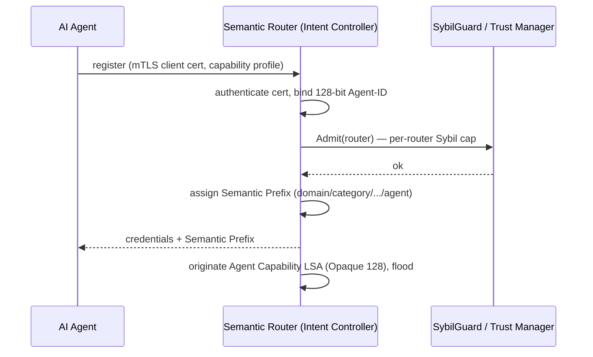
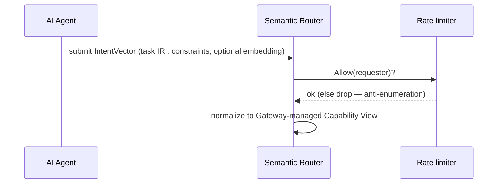
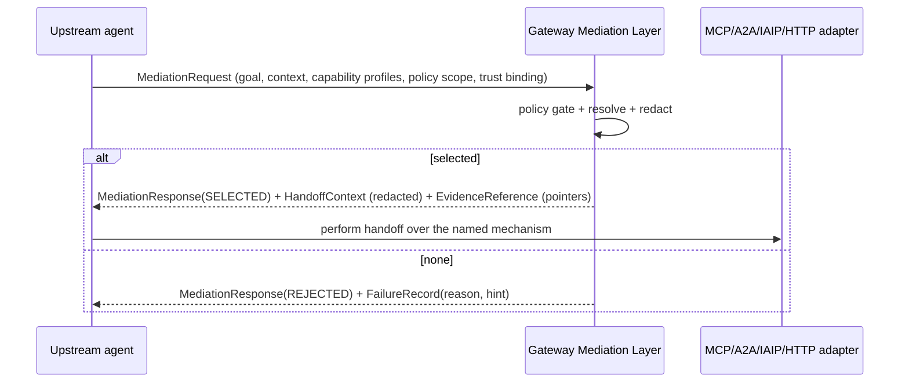

# FLOWS — the five SRA procedures as sequence diagrams

These realize draft-li §6 (SPEC_NOTES §1) end to end (brief §5.7). Diagrams are
Mermaid; they render on GitHub.

## 1. Agent Registration



## 2. Intent Submission



## 3. Policy Translation

```mermaid
sequenceDiagram
    participant R as Semantic Router
    participant P as Policy Engine (DSL)
    loop each candidate agent
        R->>P: Evaluate(intent category, domain, tenant, trust, disclosure)
        P-->>R: Allow | Deny | Constrain(min_trust, max_disclosure)
    end
    R->>R: drop denied; tighten constraints for constrained
```

## 4. Routing Execution

```mermaid
sequenceDiagram
    participant R as Semantic Router (SPF + Resolver)
    participant T as Trust Manager
    participant F as Semantic Forwarding Table
    R->>R: Stage 1 — Dijkstra SPF over LSDB (IGP cost, next hop)
    R->>R: Stage 2 — capability match (exact/subclass/embedding) -> Compatible/Incompatible/Indeterminate
    R->>T: trust per candidate
    R->>R: Stage 3 — CSPF prune hard constraints; rank by composite cost; top-k ECMP
    R->>F: install SFT entry (next hop, target, cost, expiry)
    R-->>R: RoutingDecision (one target + expiry) or FailureRecord(reason)
```

## 5. Telemetry Feedback (closed loop)

```mermaid
sequenceDiagram
    participant Te as Telemetry Agent
    participant D as Damper (hysteresis)
    participant T as Trust Manager (EWMA)
    participant R as Router
    Te->>D: latency / success / load samples
    D-->>Te: report only beyond the band (no route flap)
    Te->>T: Update(agent, outcome)
    T->>T: EWMA + decay; NeedsReOrigination?
    alt threshold crossed (and MinLSInterval ok)
        T->>R: originate Trust LSA (Opaque 129), flood
        R->>R: re-resolve affected intents -> traffic re-routes
    end
```

## Gateway mediation (handoff preparation, draft-yang -02)


